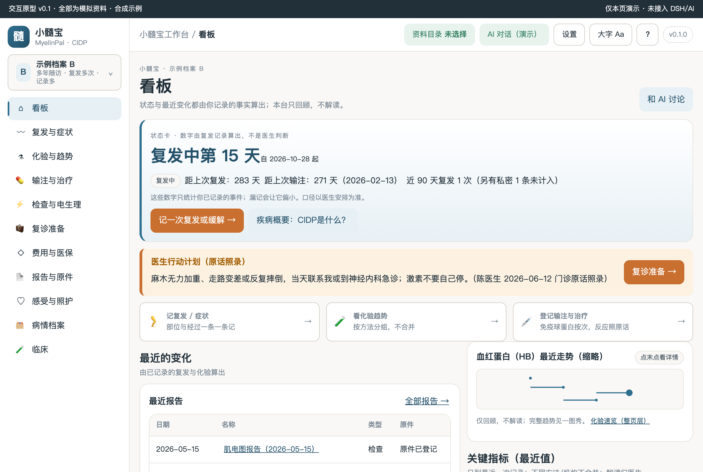
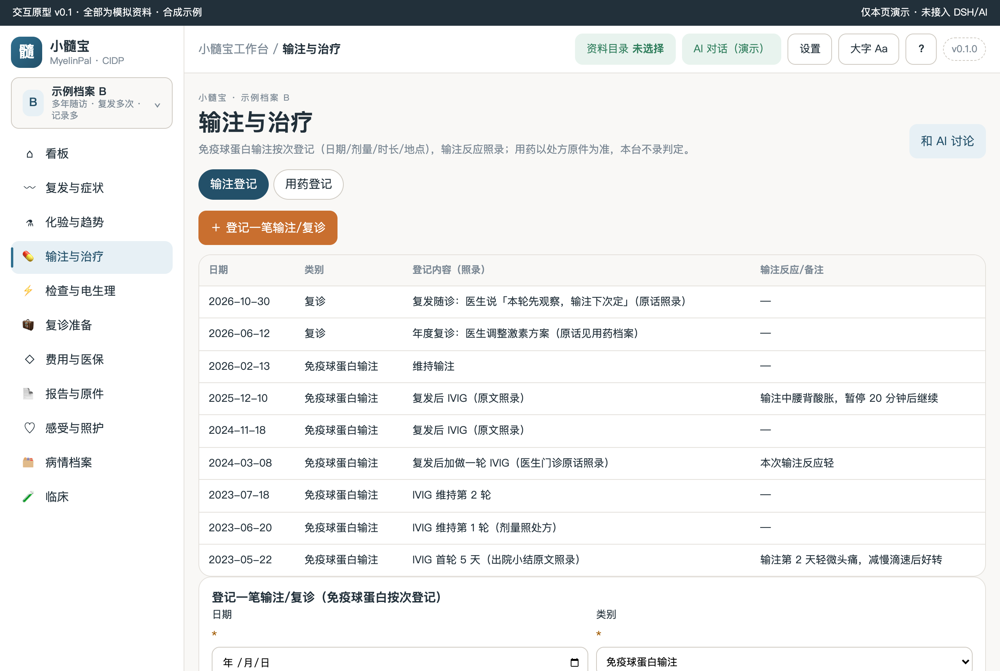
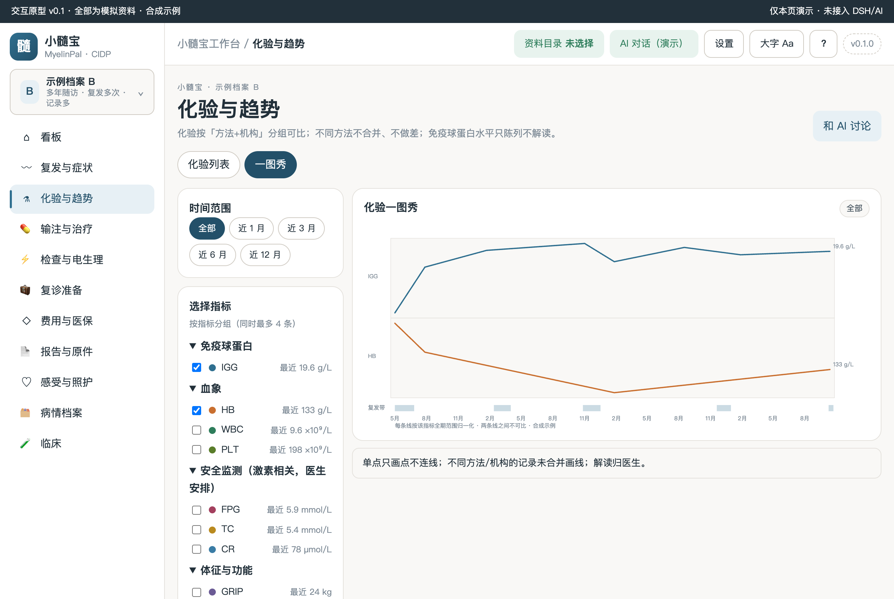
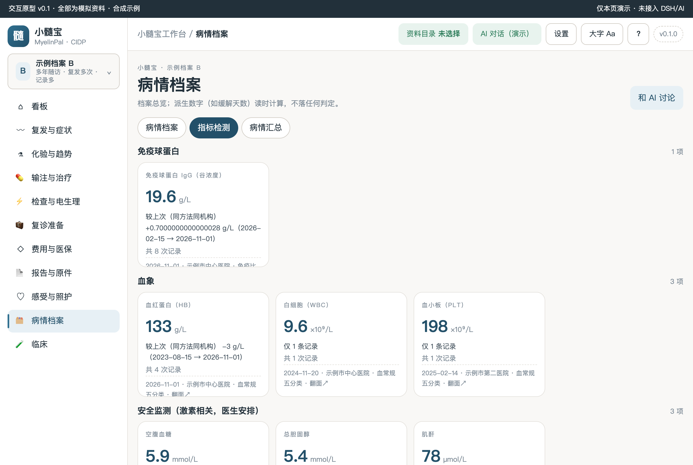
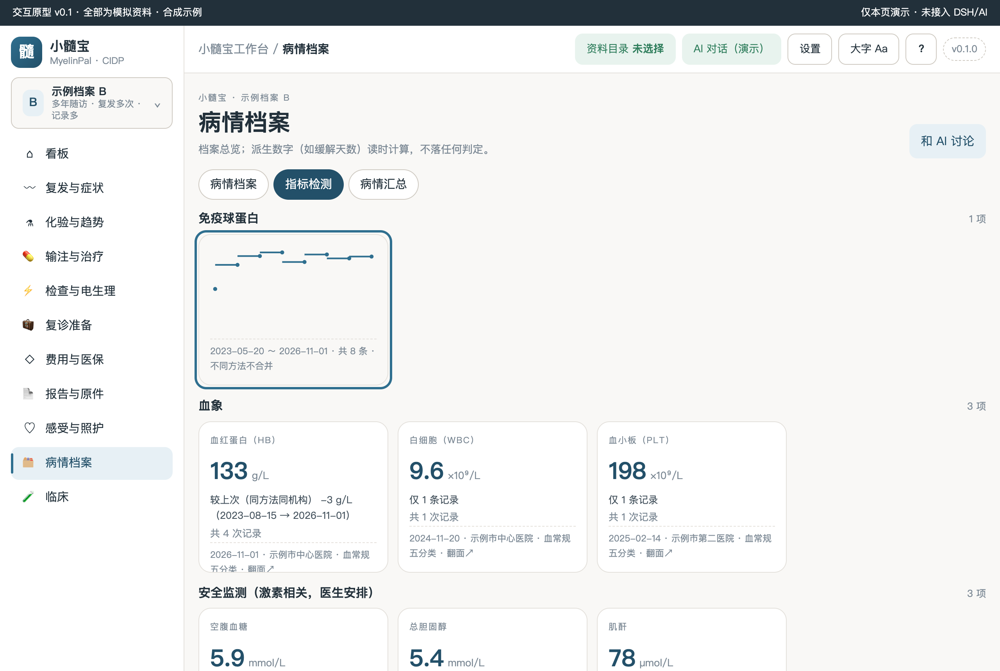
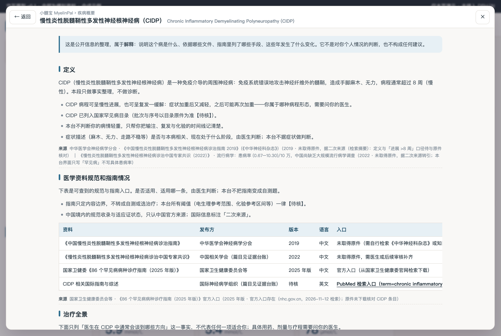
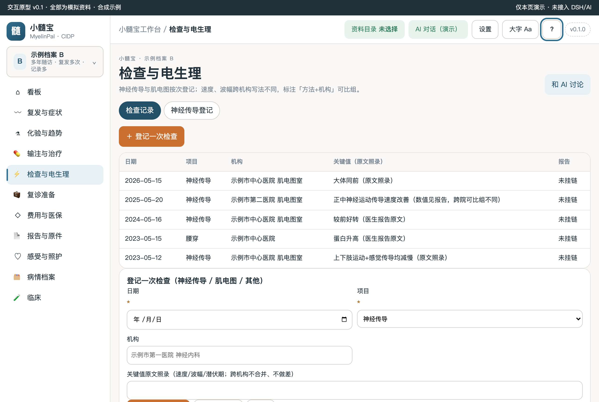

# 小髓宝 MyelinPal CIDP 工作台

本机优先的慢性炎性脱髓鞘性多发性神经根神经病（CIDP）患者工作台：免疫球蛋白输注按次登记、复发—缓解时间线、神经电生理复查档案、激素安全监测化验、费用与医保负担记录、复诊问题清单。

> 状态：M2 原型完成（prototypes/v0.1 渲染截图如下）· 全部为合成示例 · 未接入宿主 · 0 患者访谈 0 临床审核（如实标注）

## 疾病概要

工作台内顶栏「?」或首页文字按钮「疾病概要：CIDP是什么？」可打开四段整页概要，每段带来源行（原件/官方入口/二次来源/nolink+note 四态如实标注）。概要只属解释层，不生成判断；固定出口含「不代表任何一项适合你」「需要问你的医生」。

### 定义

CIDP（慢性炎性脱髓鞘性多发性神经根神经病）是一种免疫介导的周围神经病：免疫系统错误地攻击神经纤维外的髓鞘，造成手脚麻木、无力，病程通常超过 8 周（慢性）；病程可呈慢性进展或复发—缓解。

### 医学资料规范和指南情况

中华医学会神经病学分会《中国 CIDP 诊治指南 2019》（原件未取得，据二次来源）；《CIDP 诊治中国专家共识 2022》；国家卫健委《86 个罕见病病种诊疗指南（2025 年版）》官方入口存在（CIDP 条目归属待核）；PubMed 国际文献检索入口。

### 目前治疗全景概要

一线方向 =糖皮质激素 / 静脉注射免疫球蛋白（IVIG）/ 血浆置换（中国指南口径，二次来源）；支持与康复方向（功能锻炼、防跌倒、激素安全监测）；难治与维持方向（免疫调节药物，境内获批状态未核）。按受累器官与病情轻重排列，不代表任何一项适合你。

### 发展趋势

CIDP 已列入国家罕见病目录（批次与序号以目录原件为准【待核】）；2019 版中国指南已发布（二次来源）。本台不写预测性内容，每一句带来源行，没有来源的写「待核」。患病率数据中国尚缺乏大规模流行病学调查——界面只写「罕见病」，不冒充精确数字。

## 关键功能（实渲截图 · v0.1）


看板状态卡：**复发中第 15 天**由你标记的复发记录算出（不是医生判断）；「距上次输注 271 天」只报最近一次输注的事实间隔，不排程；近 90 天复发次数统计读时算，私密记录不计入并有标注。


免疫球蛋白输注按次登记（日期/类别/内容照录/输注反应），三态保存（保存并继续录入/保存并关闭/取消）支持连续补录；医生交代的特殊要求照抄原话。


一图秀左 rail：时间窗 chips + 按指标分类勾选（免疫球蛋白/血象/安全监测/体征）+ 复发带开关；每条线按该指标全期范围归一化并标注「不可比」；末点唯一数值标签；单点不连线；关闭复发带不改数据线。



指标检测页 3D 翻转卡（194px 定高，翻转不改变栅格高度）：正面最近值/较上次（同方法同机构可比组内）/来源；背面缩略走势；键盘可翻，`aria-pressed` 与 class 双通道。


顶栏「?」打开的疾病概要整页面板：四段顺序固定，每段来源行按四态标注；「返回」与「✕」双入口，Esc 退一层，焦点回归。


神经传导/肌电图按次登记：关键值原文照录；跨机构标注「方法+机构」可比组，不合并、不做差；判读归医生。

其余页面：复发与症状（复发—缓解区间带泳道）、费用与医保（逐笔登记 + 读时算汇总）、复诊准备（问题清单 + 多医院卡片）、报告与原件（列表 + 原件墙）、感受与照护（私密支持）、病情档案（汇总 + 还缺什么）。

## 怎么用

- **看原型**：`cd prototypes/v0.2 && python3 -m http.server 8141`（或任意静态服务器）后打开 `http://127.0.0.1:8141/index.html`；直接双击 index.html 亦可（演示面板形态）。
- **切换档案**：侧栏档案卡点开，A（刚确诊记录少）/ B（多年随访记录多）两套合成示例，整页数据、图表、卡片、时间线全部联动，不串档。
- **AI 对话**：原型内为演示态（草稿只填不发，未接通明说）；开发版按 DSH 原生会话合同接入（无会话经宿主 `newSession` 创建，取消目录选择/失败均有面板提示）。
- **私密标记**：任意记录可标私密；私密不进看板摘要、导出与 AI 上下文（三出口同一过滤），页内显示「N 条中私密 M 条」。

## 数据与口径

- **演示唯一源**：`prototypes/v0.2/demo-data.js`——页面不写死业务数字，指标元数据（metricDefs/metricGroups）也在这里，两套档案 A/B 全部合成示例。
- **口径三句**：仅回顾，不解读；不同方法/机构不合并、不做差；解读归医生。
- **非肿瘤表达**：复发—缓解（无病期/线序/疗效/生存期）；阈值一律【待核】；量表只录医生原文。
- **证据分级**：疾病概要数据见 `docs/EVIDENCE-LEDGER.md`（E1–E7，全部如实标注来源级别；0 临床审核）。
- **临床试验线**：按 M4 实测快照量级决定保留或裁剪；当前裁剪说明在「临床」页与设置·临床数据库 tab 同口径展示，不静默缺失。

## 开发

```bash
npm install
npm run check     # 静态门禁（含 check-agent-pane-contract 7 条 AI 面板契约、探针覆盖 21 路由对账）
npm test          # （M5 起接入）
npm run audit     # 家族一致性（版本/面板/检查链/文档/密钥）
node scripts/probe-cidp-m2.mjs            # 全量 39 断言（自起服务）
node scripts/probe-disease-primer.mjs --url http://127.0.0.1:<port>/prototypes/v0.2/index.html   # 疾病概要 10 断言
node scripts/probe-page-view.mjs --url http://127.0.0.1:<port>/prototypes/v0.2/index.html        # 整页视图 13 断言
```

- 探针必须显式 `--url` 指向**本仓原型**（不带 --url 打的是 starter examples 参考页，等于没查——家族真实发生过）。
- 结构基准：小粉宝 v0.4（hero/五Tab/指标卡3D/primer 接线）+ 小橙宝 v0.2（导航分组/泳道/AI 面板）；只抄结构与元素体系，不抄病种语义。
- 文档：[SPEC](docs/SPEC.md) · [DEV-REQUIREMENTS](docs/DEV-REQUIREMENTS.md) · [INTERACTION-DESIGN](docs/INTERACTION-DESIGN.md) · [DIFF-MATRIX](docs/DIFF-MATRIX.md) · [DEV-PLAN](docs/DEV-PLAN.md) · [PROGRESS](PROGRESS.md)
- 版本：包版本见 [VERSION](VERSION)；CHANGELOG 见 [CHANGELOG.md](CHANGELOG.md)。改包必升版。
